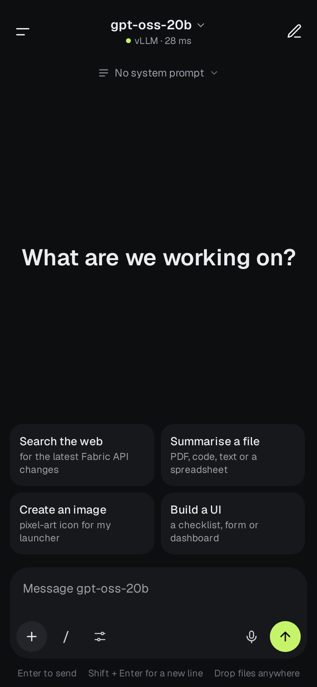
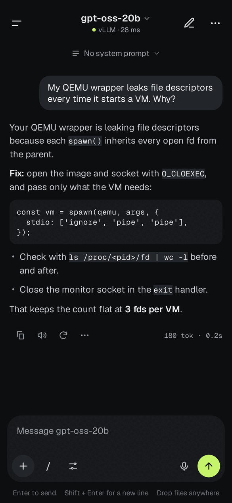
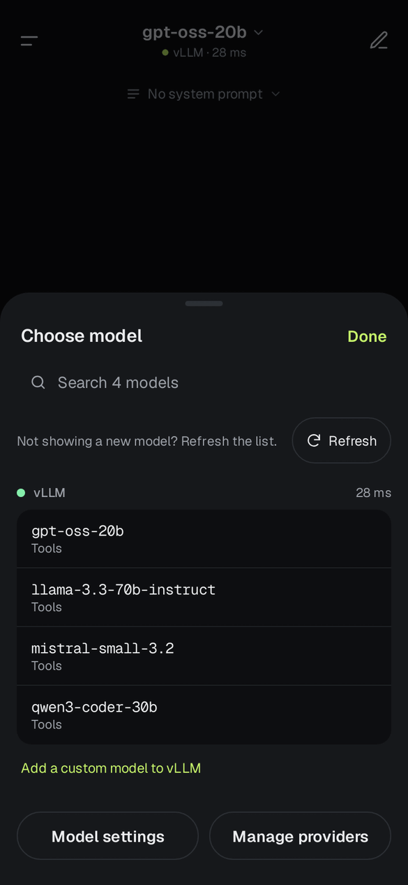
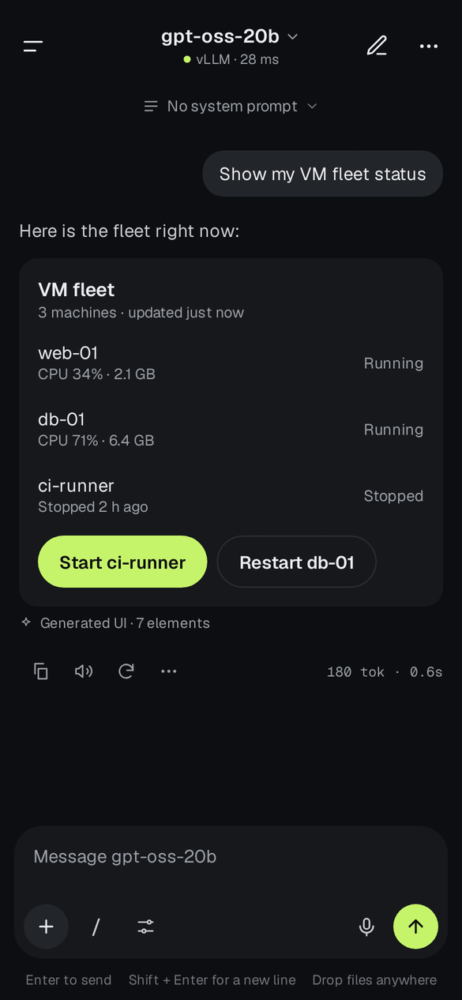
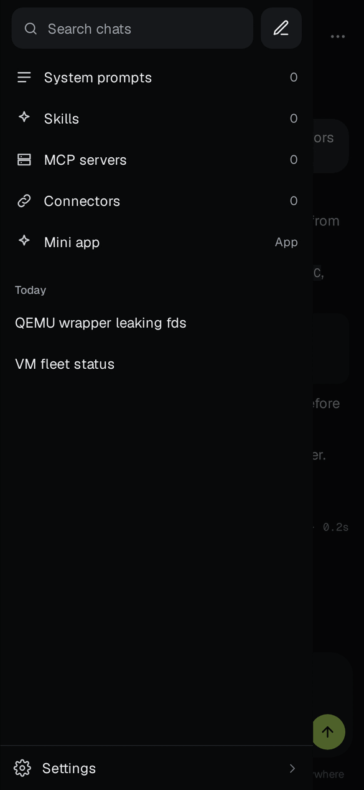
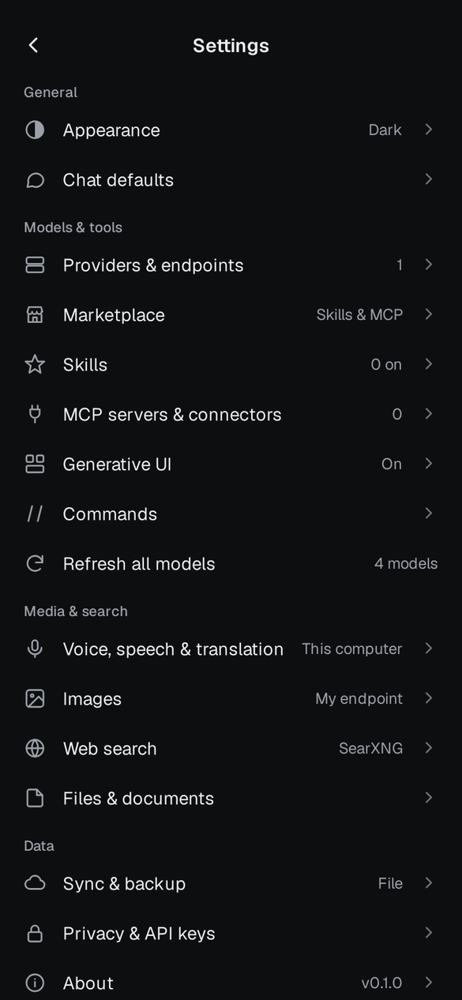
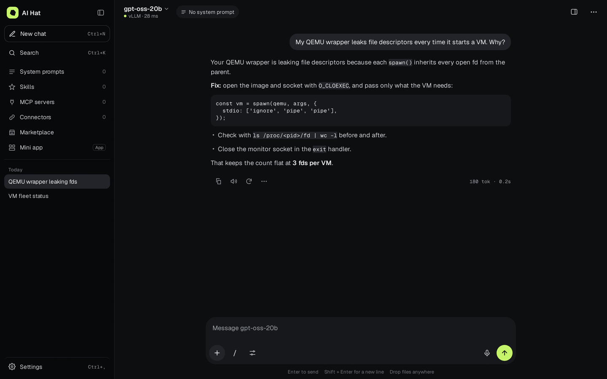

<div align="center">


# AI Hat

**A dark-first chat app for any OpenAI-compatible endpoint, on your phone, tablet and computer.**
Chat, draw images, talk, search the web, read PDFs and build small UIs, all from servers you choose.

[](#known-limitations-beta)
[](https://github.com/aman-mohammed-max/aihat/releases)
[](https://github.com/aman-mohammed-max/aihat/releases)


[](LICENSE)

[**Download**](#download) · [Quick start](#quick-start) · [Commands](#slash-commands) · [Report a bug](https://github.com/aman-mohammed-max/aihat/issues/new?template=bug_report.md)

</div>

> **⚠️ This is a beta.** It works, but expect rough edges, and some things are not built yet (see [Known limitations](#known-limitations-beta)). It has no account system and no servers of its own. Your messages go only to the endpoints you add.

## Download

Every change to `main` is built automatically and published on the **[Releases page](https://github.com/aman-mohammed-max/aihat/releases)**:

| | Android | iPhone / iPad |
|---|---|---|
| **Latest beta build** (updated on every change) | [**AI-Hat-beta-latest.apk**](https://github.com/aman-mohammed-max/aihat/releases/download/beta-latest/AI-Hat-beta-latest.apk) (universal) · smaller, one processor type: [arm64](https://github.com/aman-mohammed-max/aihat/releases/download/beta-latest/AI-Hat-beta-latest-Android-arm64.apk) · [arm32](https://github.com/aman-mohammed-max/aihat/releases/download/beta-latest/AI-Hat-beta-latest-Android-arm32.apk) · [x86_64](https://github.com/aman-mohammed-max/aihat/releases/download/beta-latest/AI-Hat-beta-latest-Android-x86_64.apk) · [x86](https://github.com/aman-mohammed-max/aihat/releases/download/beta-latest/AI-Hat-beta-latest-Android-x86.apk) | [**AI-Hat-beta-latest-unsigned.ipa**](https://github.com/aman-mohammed-max/aihat/releases/download/beta-latest/AI-Hat-beta-latest-unsigned.ipa) |
| **Numbered releases** (fixed versions) | `AI-Hat-v0.1.0-beta.1.apk` and so on, [on the releases page](https://github.com/aman-mohammed-max/aihat/releases) | `AI-Hat-v0.1.0-beta.1-unsigned.ipa` and so on |

**Computers** (the same app in a small desktop window; see [On tablets and computers](#on-tablets-and-computers)):

| | Mac | Windows | Linux |
|---|---|---|---|
| **Latest beta build** | [Apple Silicon](https://github.com/aman-mohammed-max/aihat/releases/download/beta-latest/AI-Hat-beta-latest-macOS-arm64.dmg) · [Intel](https://github.com/aman-mohammed-max/aihat/releases/download/beta-latest/AI-Hat-beta-latest-macOS-x64.dmg) (`.dmg`) | [Intel / AMD](https://github.com/aman-mohammed-max/aihat/releases/download/beta-latest/AI-Hat-beta-latest-Windows-x64-Setup.exe) · [ARM](https://github.com/aman-mohammed-max/aihat/releases/download/beta-latest/AI-Hat-beta-latest-Windows-arm64-Setup.exe) (`Setup.exe`) | [x64](https://github.com/aman-mohammed-max/aihat/releases/download/beta-latest/AI-Hat-beta-latest-Linux-x64.deb) · [ARM](https://github.com/aman-mohammed-max/aihat/releases/download/beta-latest/AI-Hat-beta-latest-Linux-arm64.deb) (`.deb`)<br>[x64](https://github.com/aman-mohammed-max/aihat/releases/download/beta-latest/AI-Hat-beta-latest-Linux-x64.flatpak) · [ARM](https://github.com/aman-mohammed-max/aihat/releases/download/beta-latest/AI-Hat-beta-latest-Linux-arm64.flatpak) (Flatpak) |

**Which file?** On Android, the universal APK works everywhere; the others are smaller because each holds the app for one kind of processor: **arm64** (nearly every phone from the last several years), **arm32** (older 32-bit phones), **x86_64** and **x86** (Chromebooks, tablets and emulators with Intel or AMD chips). iPhones and iPads are all 64-bit ARM, so there is one IPA. Macs come as Apple Silicon or Intel. Windows comes for Intel / AMD (x64) and ARM. Linux comes for x64 and ARM64, as a `.deb` (Debian, Ubuntu) and as a Flatpak (any distribution). There are no 32-bit computer versions: the desktop app runs on Bun, which only exists for 64-bit systems.

If a link says "not found", the first build hasn't finished yet. Builds take roughly 15 to 40 minutes; follow progress under the repository's **Actions** tab. Every release lists its files with SHA-256 checksums.

**Install on Android:** download the APK on your phone, open it, allow "Install unknown apps" for your browser or Files app, then tap Install. Android may warn that the app isn't from the Play Store. That's expected for a beta distributed here.

**Install on iPhone / iPad:** the IPA is **unsigned**, so it can't be installed by tapping it. Open it with [AltStore](https://altstore.io), [SideStore](https://sidestore.io) or [Sideloadly](https://sideloadly.io), which sign it with your own Apple ID. Apps signed with a free Apple ID expire after 7 days and need re-signing.

**Install on a Mac:** open the `.dmg` and drag AI Hat to Applications. It isn't signed by Apple yet, so the first time, right-click the app and choose **Open** (or System Settings › Privacy & Security › **Open Anyway**). If macOS says the app is damaged, run `xattr -cr "/Applications/AI Hat.app"` in Terminal once.

**Install on Windows:** run the Setup `.exe`; AI Hat appears in the Start menu and on the desktop. SmartScreen may say it protected your PC because the app isn't signed yet: choose **More info › Run anyway**. It uses Microsoft Edge WebView2, which Windows 10 and 11 already have.

**Install on Linux (Debian, Ubuntu and their relatives):** `sudo apt install ./AI-Hat-…-Linux-x64.deb` (or `-arm64.deb`), or open the file with your software installer; apt fetches WebKitGTK 4.1 for you. AI Hat appears in your app menu, and `ai-hat` starts it from a terminal. Needs Debian 12, Ubuntu 22.04 or newer.

**Install on any Linux (Flatpak):** with [Flathub set up](https://flathub.org/setup), run `flatpak install --user ./AI-Hat-…-Linux-x64.flatpak` (or `-arm64.flatpak`); it fetches the GNOME runtime it needs. Start it from your app menu or with `flatpak run com.amanm.aihat`.

## What it does

- **Chat with any OpenAI-compatible server**: vLLM, Ollama, LM Studio, OpenRouter, Groq, [FreeLLMAPI](https://github.com/tashfeenahmed/freellmapi) or your own. Replies stream in; add as many endpoints as you like and switch per chat.
- **Slash commands**: type `/` for 50+ commands, and add your own. [`/image`](#slash-commands) has the chat model write a detailed image prompt and then draws it.
- **Images**: your endpoint's `/v1/images/generations`, ComfyUI or AUTOMATIC1111. Choose the model, aspect ratio and count from the chat box.
- **Voice**: tap the mic for a small bar above the message box (no full screen): a red dot, a timer, a level meter and, when the phone's own speech service does the listening, **your words as you speak**. Or dictate through your own Whisper-style endpoint. Optional translation. Replies can be read aloud with pause and stop.
- **Skill scripts** (optional): skills that come with Python or Node scripts can run them to make Word, Excel, PowerPoint and PDF files. On a phone they run offline in a sandbox after a one-time 36 MB download you agree to (no internet, only the chat's files); on a computer, with its own Python and Node. The app asks before each run. Details: [SKILL_EXEC_RESULTS.md](SKILL_EXEC_RESULTS.md).
- **Web search** with sources: SearXNG, Brave, Tavily, or your endpoint's `/v1/search`. Models with tool calling can search by themselves.
- **Files**: text, Markdown, CSV and code, plus **PDF, Word, PowerPoint and Excel**, read on the phone. Long files are searched by meaning instead of sent whole (needs an embeddings endpoint).
- **Generative UI**: ask for a checklist, form or dashboard and get an interactive one in the chat, drawn with the app's own components ([json-render](https://json-render.dev)).
- **Marketplace**: browse and add **skills** (from the companies that publish them themselves, such as Vercel, Cloudflare, Stripe and Supabase; from claude-plugins.dev, skills.sh or any public GitHub repository) and **MCP servers** (from the official MCP registry), after reading what you're adding. Skills keep their reference files, which the assistant can open; downloads from websites are checked against the checksum the site publishes.
- **Skills and MCP as commands**: every skill and every MCP server is also a slash command (`/pdf fill in this form`, `/github list my open pull requests`). Skills marked Automatic are listed to the model and opened only when a task matches, so many skills cost little.
- **Tools**: system prompt library with variables, skills, and MCP servers with a per-tool Auto / Ask / Off setting. Servers are hosted ones reached over the internet: paste a token or **sign in with your browser**. Tools that run code or change things ask first.
- **Reasoning effort** (`low` to `high`), temperature and other model settings, per chat.
- **Always shows what it's doing**: a small activity box names the current step (searching the web, reading a file, improving your prompt, drawing, running a tool) with a timer and the query or prompt behind it.
- **Reply-ready notifications**: get a notification when a reply or image finishes while you're in another app or another chat. Switch it off in Settings › Chat defaults.
- **Yours to keep**: chats are stored on your device in SQLite, API keys in the OS keystore or keychain (never backed up), JSON backup and restore, optional app lock with Face ID or fingerprint on phones.
- **Phone, tablet and computer**: the layout follows the window. Tablets get an icon rail with a menu that slides over, two-pane settings and dialogs instead of bottom sheets; computers get the full side menu, a sources panel beside the chat, ⌘K / Ctrl+K search for everything, keyboard shortcuts and drag-and-drop files.
- **Looks**: dark by default, light theme, six accent colours, text size, button shape, and haptics tuned for iPhone and Android.

## Screenshots

Real screenshots of the current app (the web build at phone and desktop size, talking to a local test server).

<table>
<tr>
<td align="center"><br><sub>New chat</sub></td>
<td align="center"><br><sub>Chat</sub></td>
<td align="center"><br><sub>Model picker</sub></td>
<td align="center"><br><sub>Generated UI</sub></td>
</tr>
<tr>
<td align="center"><br><sub>Side menu</sub></td>
<td align="center"><br><sub>Settings</sub></td>
<td align="center" colspan="2"><br><sub>On a computer</sub></td>
</tr>
</table>

## Quick start

1. **Open the app → Add an endpoint.** Pick a preset (or Custom), enter the base URL **including `/v1`**, add a key if the server needs one, and tap *Test & add*. The model list is fetched automatically.
   A server running on the phone itself (for example in Termux on Android) can use plain `http://127.0.0.1:…`. Use `https://` for anything over the internet.
2. **Start chatting.** Tap the model name at the top to switch models.
3. **Try a command.** Type `/` and look around, or try `/image a cozy cabin in snow`.

### Use a different server for each feature

Images, speech, dictation, file search and web search each have their own **Endpoint** and **Model** rows (Settings → Images, Voice & speech, Web search, Files & documents). By default they follow your default endpoint. Pick another one you added, or add one just for that feature.

| Feature | What the app calls |
|---|---|
| Chat | `POST /v1/chat/completions`, `GET /v1/models` |
| Images | `POST /v1/images/generations` (or ComfyUI / A1111) |
| Read aloud | `POST /v1/audio/speech` |
| Dictation | `POST /v1/audio/transcriptions` and `/translations` |
| File search | `POST /v1/embeddings` |
| Web search | `POST /v1/search` on your endpoint, or SearXNG / Brave / Tavily |

> **Gateways that don't list or label every model** (FreeLLMAPI, for example, may not list its image and audio models): open the feature's **Model** row and choose **Add a custom model**. Tap a common id such as `whisper-large-v3-turbo` or `gemini-2.5-flash-preview-tts`, or type the id your provider shows. Tap **Refresh** any time to fetch new models.

## Slash commands

Type `/` in the chat box, or tap the `/` button. Commands that need text insert themselves; the rest run right away. Once you have skills or MCP servers, the list gets **Skills** and **MCP** filters. Settings → **Commands** lists everything and lets you write your own (a name plus a prompt, with `{input}` for the text after it).

| Command | What it does |
|---|---|
| `/image <idea>` | The chat model writes a detailed image prompt, then the image model draws it. Options: `--model id`, `--ratio 16:9`, `--n 2`, `--raw` (skip the rewrite). |
| `/search <question>` | Search the web, then answer with sources. |
| `/ui <what to build>` | Reply with an interactive UI. |
| `/prompt <description>` | The model writes a new system prompt, saves it, and uses it in this chat. |
| `/effort off\|low\|medium\|high` | How much the model should think. |
| `/model`, `/temp`, `/system`, `/tools` | Change the model, temperature, system prompt or tools. |
| `/new`, `/clear`, `/rename`, `/title`, `/pin`, `/archive`, `/delete` | Manage the chat. |
| `/summarize`, `/translate`, `/explain`, `/tldr`, `/fix`, `/review`, `/proofread`, `/rewrite`, `/plan`, `/brainstorm` | Ready-made prompts. |
| `/copy`, `/read`, `/retry`, `/export`, `/files`, `/voice`, `/refresh` | Work with replies, files and models. |
| `/status`, `/usage`, `/doctor` | Show what this chat is using, tokens and time used, and whether the endpoint answers. |
| `/compact [focus]`, `/fork`, `/resume` | Continue from a summary in a fresh chat, copy the chat into a new one, or reopen an earlier chat. |
| `/theme`, `/feedback` | Switch dark or light, or report a problem. |
| `/market` | Browse and add skills and MCP servers. |
| `/<skill> <what to do>` | Use one of your skills for this message, for example `/pdf merge these two files`. It is loaded in full, even if the skill is set to "When I ask". |
| `/<server> [what to do]` | Turn an MCP server's tools on for this chat and, if you add text, ask. `/<server> off` turns them off. |

Start a message with `//` to send a real slash.

## On tablets and computers

The app follows the width of its window, the same way on an iPad, an Android tablet, a foldable or a desktop window:

| | Phone (under 700 px) | Tablet (700–1099 px) | Computer (1100 px and up) |
|---|---|---|---|
| Menu | Drawer | 64 px icon rail; the full menu slides over | Side menu, foldable to the rail (⌘B / Ctrl+B) |
| Model, prompt, tools, + menu | Bottom sheets | Centred dialogs; the model picker opens under its button | Same, plus ⌘K / Ctrl+K to search chats, commands and settings |
| Chat | Full width | 760 px column | 760 px column; sources in a side panel from 1280 px |
| Settings | A list, then a page | Sections beside the page | Sections, list and detail side by side (Providers) |

Phones stay upright; tablets turn freely.

**The desktop app** is the same app built for the web (React Native Web) inside [Electrobun](https://blackboard.sh/electrobun/): a window that uses the computer's own web view (WebKit on macOS and Linux, Edge WebView2 on Windows) and a [Bun](https://bun.sh) backend, instead of shipping a whole browser the way Electron does. The download is tens of megabytes rather than the 100–250 MB of an Electron app. The Bun backend keeps your chats in SQLite in your user folder, keeps API keys in the system keychain (macOS Keychain, Windows Credential Manager, GNOME Keyring or KWallet on Linux; without a keyring, a file only you can read), reaches your endpoints and MCP servers without the browser's cross-site limits, saves exports to Downloads, shows notifications and brings browser sign-ins back to the app. It only listens on your own computer (127.0.0.1), and every request to it needs a key that changes each time the app starts.

## Files it can read

Plain text, Markdown, CSV, JSON, code, **PDF**, **Word (.docx)**, **PowerPoint (.pptx)** and **Excel (.xlsx)**. **Scanned PDFs** (pictures of pages) are sent as page pictures, so pick a model marked **Vision** to read them (up to 20 pages; black-and-white fax-style scans can't be converted yet). Password-protected files can't be read. The app tells you why instead of silently dropping a file.

## Privacy

There is no account, no analytics and no server of ours. Messages, images and files go only to the endpoints **you** add. The exceptions are things you ask for: **dictation with the phone's speech service** sends your voice to Apple or Google unless you turn on "Only on this phone" (or dictate with your own endpoint), and the **marketplace** talks to registry.modelcontextprotocol.io, claude-plugins.dev, skills.sh and GitHub when you open it. API keys and tokens are kept in the phone's secure keystore (on a computer, the system keychain) and are never written to backups. If you use a cloud endpoint, your messages go to that company, so choose accordingly.

## Known limitations (beta)

- **iOS builds are unsigned**, so they need AltStore, SideStore or Sideloadly.
- **Developed and tested mainly on iPhone.** The Android build is newer and has had less testing.
- **No on-device language models.** Live-text dictation uses the phone's speech service (Apple on iPhone, Google on Android), which is a native module that **Expo Go doesn't include**: in Expo Go the mic uses your transcription endpoint instead. It is untested on real phones so far; please report problems.
- **Skill scripts are never run on the phone.** The text files that come with a skill (references, templates, scripts) are stored and the assistant can read them, but Python and shell scripts don't execute. With a hosted code-running MCP server connected, the assistant can pass a script to it. Skills and MCP servers are written by other people: read before you add.
- **skills.sh has no public API for apps.** Its documented API needs a Vercel server token, so the app uses the search endpoint its own command line tool uses, which may change. The other sources (company websites, GitHub, claude-plugins.dev) keep working if it does.
- **Browser sign-in for MCP servers** works with servers that let apps register themselves (Notion, Linear, Sentry, Vercel, Stripe, Supabase, Figma, Canva, PayPal and others). Servers that don't (GitHub's, Asana's) need an access token. This has been tested against a stand-in sign-in service and the real servers' sign-in descriptions, not yet with a real login on a phone.
- **MCP servers that only run as a program on a computer** (“stdio” servers, started with `npx`, `uvx` or `docker`) can't be used: a phone can't start them. Hosted servers work.
- **MCP connectors use access tokens**, not browser sign-in (OAuth isn't built). Backups are a JSON file you save or share yourself; backing up straight to Google Drive and iCloud is coming soon.
- **The desktop apps are new and haven't been tried on a real Mac, Windows PC or Linux desktop yet.** The web build and its Bun backend were tested in Chromium on Linux; the windows themselves are built by GitHub Actions. They are unsigned (see Download), don't update themselves yet (download a new build from Releases), and on Linux the menu bar isn't shown (use the keyboard shortcuts). Dictation in the desktop app depends on the system web view's microphone support.
- Not available as a website: the web build needs the desktop app's backend.

## Run it from source

You need Node 22.

```bash
git clone https://github.com/aman-mohammed-max/aihat.git
cd aihat
npm install
npx expo start -c        # scan the QR code with Expo Go
```

Before sending changes: `npx tsc --noEmit` and `npx expo lint` (the **Check** workflow runs both).

**The desktop app** needs [Bun](https://bun.sh) as well:

```bash
npx expo export --platform web     # the web build, into dist/
cd desktop && bun install
bun run dev                        # the app in its window (needs WebKitGTK 4.1 on Linux)
bun run serve                      # or: the same backend, opened in your normal browser
bun test                           # backend tests
```

**Troubleshooting**
- `AggregateError [ETIMEDOUT]` with `--tunnel`: your network can't reach Expo's tunnel service. Try `NODE_OPTIONS="--dns-result-order=ipv4first --no-network-family-autoselection" npx expo start --tunnel`, or skip the tunnel and use the same Wi-Fi.
- On a Chromebook (Linux container), forward TCP port 8081 in ChromeOS settings and run `REACT_NATIVE_PACKAGER_HOSTNAME=<your Wi-Fi IP> npx expo start`.

## Project layout

```
src/app          screens and routes (Expo Router)
src/components   shared UI: header, composer, sheets, command palette…
src/store        app state (Zustand) and the SQLite data
src/api          OpenAI-compatible and MCP clients, image engines
src/lib          commands, PDF / Office readers, search, speech, titles
src/genui        generative UI (json-render catalog, renderer, parser)
desktop          the desktop app: Electrobun window and Bun backend (database, keychain, network, files)
handoff          the design mockups and spec the app follows
.github          build, release and check workflows
```

## Contributing

Bug reports and ideas are welcome: [open an issue](https://github.com/aman-mohammed-max/aihat/issues/new?template=bug_report.md). Include the app version (Settings → About), your phone, and which endpoint and model you used. Never paste API keys. Pull requests are checked by the **Check** workflow.

## License

[MIT](LICENSE). Built with [Expo](https://expo.dev), React Native, [json-render](https://json-render.dev), [fflate](https://github.com/101arrowz/fflate), [Electrobun](https://blackboard.sh/electrobun/) and [Bun](https://bun.sh).
